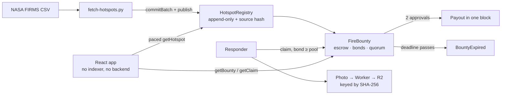

# ASAP — Fire Response Bounty Network

**Satellites find the fire. Monad pays the person who gets there.**

| | |
|---|---|
| **Live app — mainnet** | **[asapmonad.web.id/portal](https://asapmonad.web.id/portal)** · chain `143` |
| **Live app — testnet** | **[testnet.asapmonad.web.id/portal](https://testnet.asapmonad.web.id/portal)** · chain `10143` |
| **Contracts** | `HotspotRegistry` + `FireBounty`, source-verified on both chains → [addresses](#contracts) |
| **Proof it settles** | [a bounty was opened, claimed and paid out on mainnet](#proof-a-bounty-settled-on-mainnet) |
| **Demo video** | [`docs/asap-demo-30s.mp4`](docs/asap-demo-30s.mp4) — 30 s, narrated, screenshots of the live app, no mockups |
| **Long-form docs** | [SPEC](docs/SPEC.md) · [whitepaper](docs/WHITEPAPER.md) · [flow diagrams](docs/FLOW.md) |

## The gap

Indonesia's 2026 fire season is live: **17,108 hotspots on 12 October** (SiPongi, Kementerian Kehutanan), 26 provinces under haze, Jakarta breathing Kalimantan's smoke. The detection layer already works — SiPongi ingests NASA Terra/Aqua, SNPP and NOAA-20 daily.

What is missing is the last mile. A hotspot is a coordinate, not an action. The person who physically walks to that coordinate has no budget, no proof of arrival, and no payment — so most coordinates are never visited, and nobody can tell the difference.

ASAP is the layer between the satellite and the shovel. A hotspot opens a bounty; the first responder who can prove they got there is paid in one block.

## How it works

1. **Anchor the data.** A whitelisted oracle commits `keccak256` of the raw NASA FIRMS CSV, then publishes the parsed rows. Anyone can re-download the file and prove the record wasn't tampered with.
2. **Open a bounty.** Whoever carries the exposure — a concession, a carbon project, a CSR budget, a BPBD — funds a hotspot. The money sits in escrow, not in an account.
3. **Go there.** A responder stakes a bond **≥ the pool**, then submits geotagged photo evidence. The contract enforces the radius (25 km) and the timestamp (evidence cannot predate the satellite pass).
4. **Get verified.** Two whitelisted verifiers approve → payout in the same block. Two rejections → the bond is slashed 50/50 to backer and verifiers, and the bounty reopens to everyone else.
5. **Or don't.** Nobody shows up → `BountyExpired`. That event is the accountability product: a public, permanent record of a fire nobody answered.

**Invariants the contracts enforce:** bond ≥ pool makes fake reports unprofitable · evidence can't predate the satellite pass · a claim settles exactly once · the contract holds zero balance in every terminal state.

## What is live right now

| Chain | Hotspots on-chain | Bounties | Data anchored by |
|---|---|---|---|
| **Mainnet `143`** | **191** | 1 — verified and paid out | [`commitBatch`](https://monadscan.com/tx/0x10fe39adf100ea2195c06be10c0c26fd2588ebc989e0b663d0b8d1a3af3d4ede) |
| **Testnet `10143`** | **180** | 5 — 1 verified, 1 claimed, 3 open | batch `0x89eb56…`, anchored to the CSV hash |

The app reads those hotspots **one id at a time straight from `HotspotRegistry`** — no indexer, no backend, no database. The map is the chain.

### Proof a bounty settled on mainnet

Real MON, six transactions, before submission:

| Step | Transaction |
|---|---|
| Fund the two verifiers with gas | [`0x8dfb8697`](https://monadscan.com/tx/0x8dfb8697c4c24bc170ad84b2951e8197e932faacf139e96c9f01389ae0112061) · [`0x319a7931`](https://monadscan.com/tx/0x319a793111bf705e6638bf92660eb56a94cb6ed974eab592db41d832bbc982db) |
| Whitelist them as verifiers | [`0x5abb1090`](https://monadscan.com/tx/0x5abb1090a22cd923aa924e648a18d067a30721dc0ae8e9fc15df3039b12f9db6) · [`0xeb202128`](https://monadscan.com/tx/0xeb202128270870b970b86a62b1e9c1a372439b38114de44c6cd7f4ae91d7385a) |
| Open bounty #1 on hotspot 3 — 0.05 MON, 6 h | [`0xa316cf0c`](https://monadscan.com/tx/0xa316cf0c45f98746062baf49a54c6ef4fc49ed950ed294dda704ea2bef1c6614) |
| Claim it — 0.05 MON bond, 0 m from the hotspot | [`0x4427aecc`](https://monadscan.com/tx/0x4427aecc977c281719f7f2b4529f3be91353241b355a93edcf47bd3e99f63019) |
| Two approvals → payout in the same block | [`0xee754ba5`](https://monadscan.com/tx/0xee754ba5fa7dff03ee4b77848cae1317dbcb78de376b4b33a22c8ad414047439) · [`0x3265ae51`](https://monadscan.com/tx/0x3265ae5193dae64ff8e5659a89ac5a143df7da65e33f3ac26ecb70cfbbc22d15) |

Open [hotspot #3 on the mainnet app](https://asapmonad.web.id/portal#h=3) and the panel shows the verdict, the responder, the distance (0 m), the approvals (2 of 2) and the evidence hash — read back from the chain, not from a mock.

## Contracts

| Chain | Contract | Address | Source |
|---|---|---|---|
| `143` mainnet | `HotspotRegistry` | [`0xe691172812761cd8c1efcdbeb89192b35cacb9e7`](https://monadscan.com/address/0xe691172812761cd8c1efcdbeb89192b35cacb9e7) | [Sourcify](https://repo.sourcify.dev/143/0xe691172812761cd8c1efcdbeb89192b35cacb9e7) · exact match |
| `143` mainnet | `FireBounty` | [`0x6ec281aac8f6bec24ba84c56800879b66c13097a`](https://monadscan.com/address/0x6ec281aac8f6bec24ba84c56800879b66c13097a) | [Sourcify](https://repo.sourcify.dev/143/0x6ec281aac8f6bec24ba84c56800879b66c13097a) · exact match |
| `10143` testnet | `HotspotRegistry` | [`0xe691172812761cd8c1efcdbeb89192b35cacb9e7`](https://testnet.monadscan.com/address/0xe691172812761cd8c1efcdbeb89192b35cacb9e7) | [Sourcify](https://repo.sourcify.dev/10143/0xe691172812761cd8c1efcdbeb89192b35cacb9e7) · exact match |
| `10143` testnet | `FireBounty` | [`0x6ec281aac8f6bec24ba84c56800879b66c13097a`](https://testnet.monadscan.com/address/0x6ec281aac8f6bec24ba84c56800879b66c13097a) | [Sourcify](https://repo.sourcify.dev/10143/0x6ec281aac8f6bec24ba84c56800879b66c13097a) · exact match |

**The addresses are identical on both chains — that is not a typo.** The deployer's nonce was `0` on each chain, so `CREATE` produced the same deterministic address. Each row above is a separate deployment; check the explorer links.

- Compiler `0.8.24`, optimizer on, 200 runs, `shanghai`. `FireBounty` takes the registry address as its constructor argument.
- Deploy transactions — mainnet: [registry](https://monadscan.com/tx/0x60e378aa29022180b28349a2e67c36b035050b945e0ed60362ad04adf0c6ace3) · [bounty](https://monadscan.com/tx/0xf24c804655cb4859cc4e835dc19b68aa9652489ceee860856921ddc4a5afc6b0). Testnet: [registry](https://testnet.monadscan.com/tx/0x3d1b60ba02f820c6706c2a47508f10272caad8b47a4d5f0081713145a185f646) · [bounty](https://testnet.monadscan.com/tx/0xfcad1150a94b5a519e414fdf90da7a088940b01d7828ff8450849f810c6b67cc).
- Oracle / deployer: `0x9EB20B1420077de8b7e9572b9729b94090a5B8C8`, also a whitelisted verifier so the whole flow can be demonstrated end to end.

## Architecture



- **Two contracts, nothing else.** `HotspotRegistry` is an append-only record anchored to the source file; `FireBounty` holds escrow, bonds and quorum. No token, no proxy, no owner escape hatch over user funds.
- **No indexer.** The app reads `getHotspot` id by id in paced waves through three RPC endpoints, because the public endpoint returns 429 on bursts and `eth_getLogs` is capped at 100 blocks. Reads are cached in `localStorage`, keyed by on-chain count.
- **Photo evidence is content-addressed.** The browser compresses to 1280 px JPEG, uploads to a Cloudflare Worker, and R2 stores it under its SHA-256. The string written on-chain is that immutable URL — nobody can overwrite someone else's proof, and the same photo always resolves to the same object.
- **Two networks, one source tree.** The chain is chosen at *build* time (`.env.testnet` / `.env.mainnet`), so a mainnet page can never read a testnet address because of a hostname or query string.

## Run it

**Contracts** — forge-std is vendored, so a fresh clone needs no `forge install`:

```bash
cd contracts
forge test                 # 7 tests: payout, bond, radius, timestamp, slash, expiry, self-attest
forge build

forge script script/Deploy.s.sol --rpc-url monad_testnet --broadcast --private-key $PK
forge script script/Deploy.s.sol --rpc-url monad_mainnet --broadcast --private-key $PK
```

**Web app:**

```bash
cd web/frontend
npm install
npm run dev              # localhost:5173 — landing + /portal + a dev evidence endpoint
npm test                 # 220 Vitest tests
npm run build:mainnet    # chain-143 bundle  → dist-mainnet/
npm run build:testnet    # chain-10143 bundle → dist/
npm run cf:deploy:mainnet   # → asapmonad.web.id
npm run cf:deploy:testnet   # → testnet.asapmonad.web.id
```

**The whole mainnet pass in one command** — deploy, verify on Sourcify, publish the FIRMS batch, write `.env.mainnet`, build, deploy the root domain. It refuses to start while the deployer holds 0 MON on chain 143:

```bash
./scripts/deploy-mainnet.sh
```

**Data pipeline** — live NASA FIRMS, no API key required:

```bash
python3 scripts/fetch-hotspots.py --limit 200     # → web/data/hotspots.json
python3 scripts/push-hotspots.py --registry 0x... --limit 200
```

## Why Monad

- **Embarrassingly parallel workload.** Every hotspot is an independent escrow. ~22,760 FIRMS detections/day × claims × attestations is tens of thousands of *independent* state transitions — exactly the case parallel execution exists for.
- **Micro-bounty economics.** A village volunteer's bounty is ~$10–30. At $0.20 gas the mechanism is dead; at Monad fees it is noise. The mainnet run above cost ~2 MON — two deploys plus 191 rows at a measured 82,655 gas each.
- **Finality is functional.** Nobody wants to wait 30 s to learn their evidence landed while another responder claims the same fire.
- **Gas is charged on `gas_limit`, not gas used** — so 200-row batch writes must be measured, not guessed. We measured: 82,655 gas per hotspot.

## Status

| Area | State |
|---|---|
| Contracts | ✅ 2 contracts, compile clean, 7/7 tests |
| Deployments | ✅ mainnet `143` and testnet `10143`, exact-match verified |
| On-chain data | ✅ 191 mainnet / 180 testnet hotspots, anchored to the FIRMS CSV hash |
| Settlement | ✅ paid out on both chains, with real MON on mainnet |
| Web app | ✅ React 19 + Vite, 220 tests, mobile bottom sheet, wallet reconnect |
| "No responder" counter | ✅ read from bounty status 4 — 0 today; bounty #4 becomes expirable at 18:22 WIB |
| Payment receipt | ✅ responder, distance, evidence hash, approvals on every verified bounty |
| Hosting | ✅ Cloudflare Workers + custom domain, two networks from one source |

## Honest limitations

- **Satellite NRT lags reality by hours.** That is exactly why the ground layer must not be gated on it — and why the UI never says "burning now", only "detected N hours ago".
- **The radius check is a flat-earth approximation**, valid to ~1% within 8° of the equator. Haversine is v2.
- **One active claim per bounty**, so race resolution needs no reviewer today. Rejection reopens it.
- **Verification is a trusted 2-of-N quorum** of whitelisted addresses. v2 is stake-weighted verifiers with an appeal window.
- **The bond excludes the poorest responders.** At 100% of pool, a fake report is strictly unprofitable, but a volunteer with no capital cannot play. A cooperative bond pool is the roadmap item, not a shipped feature.
- **Bounty #2 on testnet holds a claim with placeholder evidence** (`ipfs://unset`). It is left in that state on purpose so the Claimed screen can be inspected.

Full list in [`docs/SPEC.md` §9](docs/SPEC.md).

## Repository map

| Path | What it is |
|---|---|
| [`contracts/src/HotspotRegistry.sol`](contracts/src/HotspotRegistry.sol) | Append-only hotspot record anchored to the source CSV hash |
| [`contracts/src/FireBounty.sol`](contracts/src/FireBounty.sol) | Escrow, responder bonds, verifier quorum, slashing |
| [`contracts/test/FireBounty.t.sol`](contracts/test/FireBounty.t.sol) | 7 tests covering every terminal state |
| [`web/frontend/`](web/frontend/) | React 19 + Vite app: landing, map, claim/attest, evidence upload, receipts |
| [`web/data/hotspots.json`](web/data/hotspots.json) | Generated FIRMS fixture the pusher reads |
| [`scripts/fetch-hotspots.py`](scripts/fetch-hotspots.py) | Pulls live FIRMS data, writes the fixture |
| [`scripts/push-hotspots.py`](scripts/push-hotspots.py) | `commitBatch` + `publish` on-chain |
| [`scripts/deploy-mainnet.sh`](scripts/deploy-mainnet.sh) | The full mainnet run, guarded by a balance check |
| [`scripts/wallet-tui.sh`](scripts/wallet-tui.sh) | Terminal wallet: balance, send, switch network |
| [`docs/SPEC.md`](docs/SPEC.md) | Architecture, sequences, state machine, contract API, invariants |
| [`docs/WHITEPAPER.md`](docs/WHITEPAPER.md) | Mechanism design, money flow, game theory, threat model, roadmap — rendered at [/whitepaper](https://asapmonad.web.id/whitepaper) |
| [`docs/FLOW.md`](docs/FLOW.md) · [`docs/diagram.html`](docs/diagram.html) | Satellite → contract → screen, money flow, marker colours |

## Data attribution

Hotspot data: **NASA FIRMS** (VIIRS SNPP C2 NRT), public domain. Haze and hotspot figures: **SiPongi**, Kementerian Kehutanan RI. Map tiles: Esri Dark Gray Canvas.

MIT licensed — see [`LICENSE`](LICENSE).
