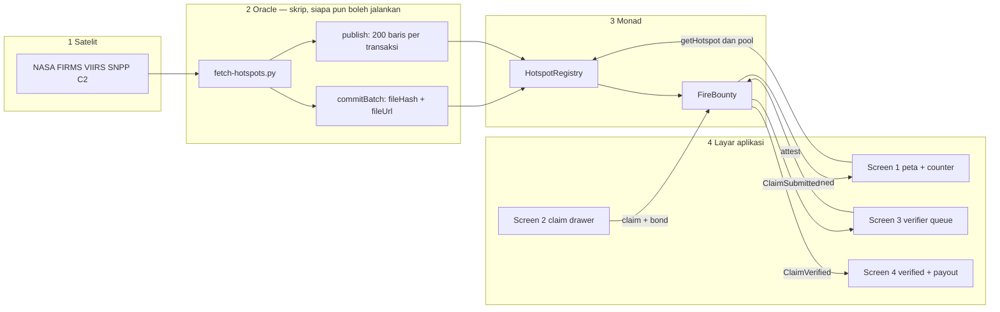
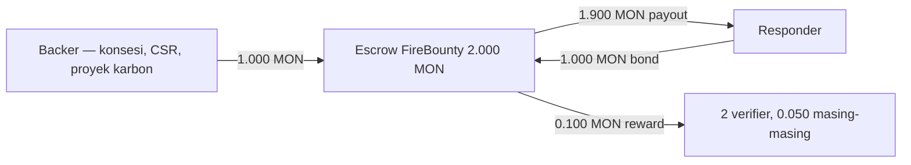
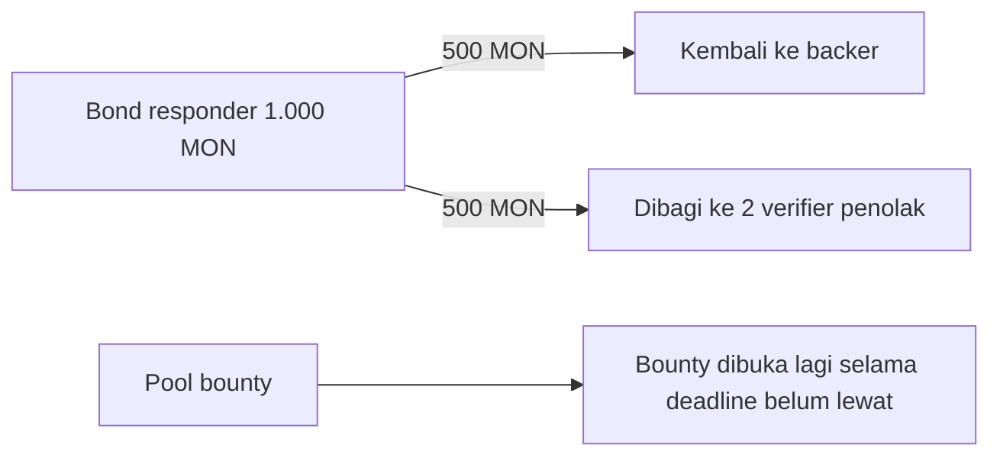
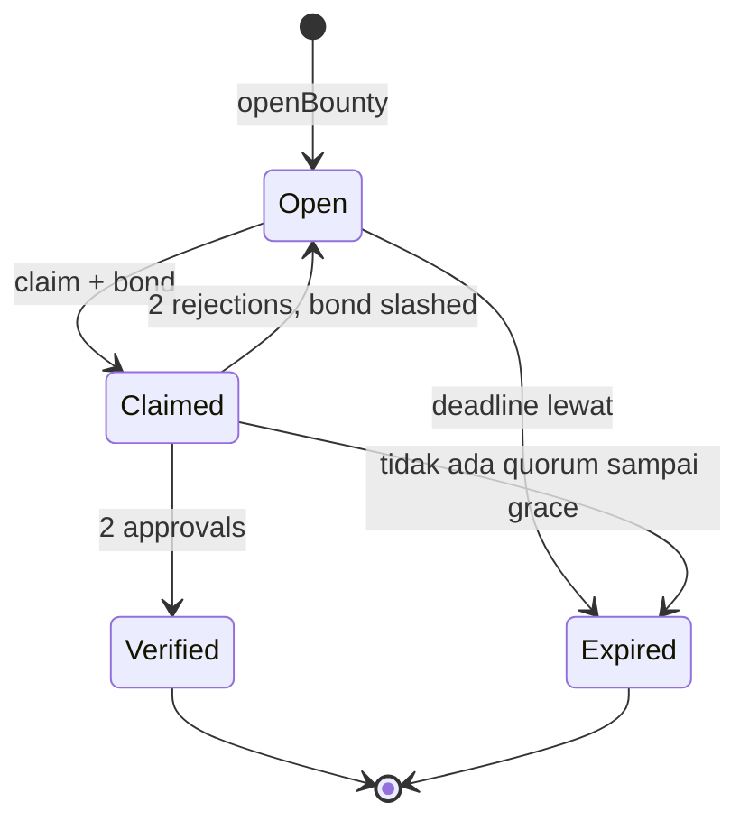
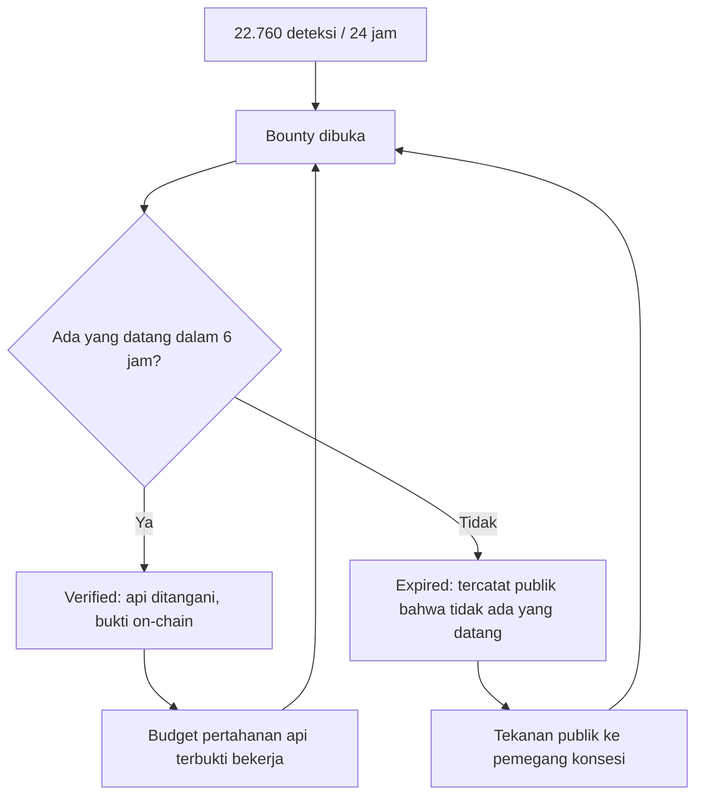

# ASAP — diagram alur

Tiga diagram untuk menjelaskan bagaimana sistem ini bekerja, dari satelit sampai ke layar aplikasi. Versi yang bisa dibuka langsung di browser: [`diagram.html`](diagram.html).

---

## 1. Dari satelit sampai layar

Yang perlu dipahami: **layar aplikasi tidak menampilkan data karangan.** Layar itu pembaca dari dua kontrak, dan kontrak itu diisi oleh skrip yang menarik file NASA.

**Cara membacanya:** panah ke kanan adalah uang dan state, panah ke kiri adalah bacaan. Layar 1 adalah pembaca pasif. Layar 2 dan 3 adalah satu-satunya tempat transaksi dikirim. Layar 4 bukan halaman terpisah — dia layar 2 setelah state berubah.

**Bagian yang belum ada:** panah dari layar 2 dan 3 ke `FireBounty` belum tersambung karena aplikasinya belum dibangun. Kontraknya sudah siap dan lulus 7 test; UI-nya pekerjaan block berikutnya.

---

## 2. Ke mana uangnya pergi

Pertanyaan pertama setiap juri. Semua angka di bawah ada di `FireBounty.sol`.

Bond = 100% pool. Artinya kalau bounty Rp 350.000, responder menyetor bond senilai itu juga, dan menerima **1,8× pool** saat lolos — bounty plus bond kembali, dipotong 10% untuk verifier.

Kalau verifier menolak:

**Konsekuensi desain yang harus kamu hafal:** nilai bond lebih besar dari imbalan maksimal sebuah kebohongan, jadi melapor palsu selalu merugi. Tapi konsekuensi lainnya — relawan miskin tidak bisa ikut. Itu trade-off yang kita pilih sadar, dan ada di bagian limitasi spec.

---

## 3. Arti warna titik di peta

Ini yang kamu klik-klik tadi, dipetakan ke state kontrak:

| Warna | State | Arti di pitch |
|---|---|---|
| Amber | Open | Ada uang menunggu, belum ada yang datang |
| Biru | Claimed | Seseorang sudah menyetor bond dan menyerahkan bukti |
| Hijau | Verified | Dua verifier setuju, payout sudah jalan |
| Merah | Expired | **Ada uang, tidak ada yang datang** — ini produknya |

---

## 4. Kenapa merah lebih penting dari hijau

Sistem lain berhenti di "api terdeteksi". Yang kita jual adalah baris terakhir: **catatan publik tentang api yang dibiarkan.** Itu yang tidak dimiliki SiPongi, dan itu yang membuat bounty berikutnya lebih mungkin dibayar.
