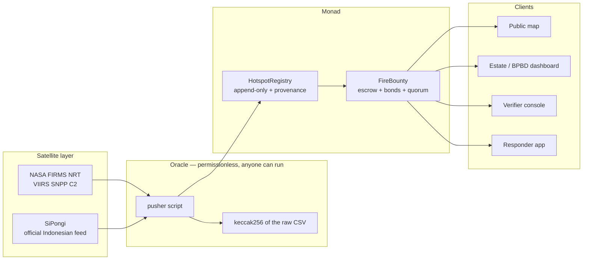
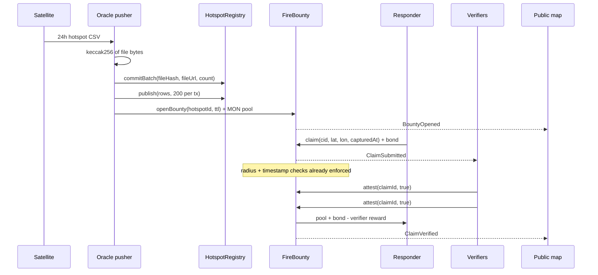
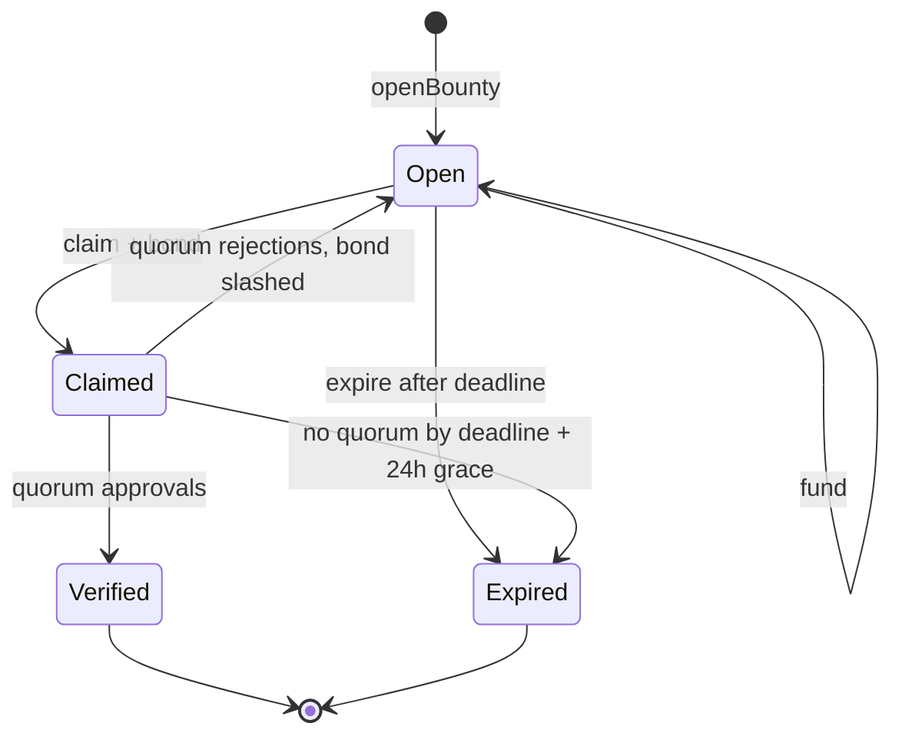
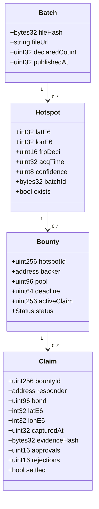

# ASAP — Fire Response Bounty Network on Monad

**One line:** satellites detect a fire, a bounty opens for it automatically, and the first person who can prove they got there gets paid — in under a second, on Monad.

**Status:** Vol. 2 build spec. Contracts implemented and tested in [`contracts/`](../contracts/). The web app is not built yet.

---

## 1. The problem

Indonesia's 2026 fire season is active right now, not hypothetically:

| Signal | Value | Source |
|---|---|---|
| Hotspots detected nationally | **17,108** (12 Oct 2026) | Kompas / SiPongi |
| High-confidence hotspots | **793** on 10 Oct, up 356 day-over-day | SiPongi, Kementerian Kehutanan |
| Provinces under haze | **26** (Aceh → Papua) + transboundary | BMKG, 15 Oct 2026 |
| Live check, 24h window | **22,760** rows in Indonesia's bbox, **919 high-confidence** | NASA FIRMS VIIRS SNPP C2, pulled during this build |
| Pekanbaru PM2.5 at build time | **55.6 µg/m³** | Open-Meteo air quality |

The detection layer already works. SiPongi ingests NASA Terra/Aqua, SNPP and NOAA-20 and publishes hotspots daily. What is missing is the **last mile**: a hotspot is a coordinate, not an action. Someone has to physically get there, and today that someone is a volunteer with no budget, no proof of arrival, and no payment.

**ASAP is the layer between the satellite and the shovel.**

It does not replace Manggala Agni, BPBD or the village fire brigades. It makes the first hour of a fire financially worth a person's time, and it produces a public record of which fires were answered and which were not.

---

## 2. What gets built

Three surfaces, one contract pair.

| Surface | Who | What it does |
|---|---|---|
| **Public map** | anyone | Live hotspots, bounty size, status. The accountability view: fires with no responder stay visible. |
| **Responder app** | volunteers, drone clubs, estate crews | See nearby bounties, stake a bond, submit geotagged photo/video as evidence, get paid. |
| **Verifier console** | Manggala Agni, BPBD, estate HSE, UGM forestry reviewers | Attest or reject claims. Two attestations settle instantly. |

Money flows in from the parties with legal or financial exposure to the fire: concession holders, carbon projects, CSR/ESG budgets, BPBD. Money flows out to whoever proves arrival.

---

## 3. Architecture



Two contracts, deliberately. Every extra contract is a place for the demo to die at 15:45.

| Contract | Responsibility | Why it is separate |
|---|---|---|
| `HotspotRegistry` | Stores hotspot facts + the hash of the source file they came from | Facts are shared by every bounty, and must be verifiable independently of who opened the bounty |
| `FireBounty` | Escrow, bonds, verifier quorum, settlement, slashing | Money logic changes; hotspot facts do not. Also lets a second consumer (e.g. carbon MRV) read the registry without touching funds |

---

## 4. Lifecycle





`Expired` is not a failure state, it is **the product**. Every expiry is a row in the accountability ledger: this fire had money on it and nobody credible showed up.

---

## 5. Data model



Coordinates are `int32` micro-degrees (`value * 1e6`) because Solidity has no floats. FRP is stored as deci-MW (`FRP * 10`) to fit `uint16` — the largest detections in the live feed are ~320 MW, and the field caps at 6,553.5 MW.

---

## 6. Contract API

### 6.1 `HotspotRegistry`

| Function | Access | Purpose |
|---|---|---|
| `commitBatch(bytes32 fileHash, string fileUrl, uint32 count) → bytes32 batchId` | publisher | Anchor the source file before writing rows. `batchId = keccak256(fileHash, count)`. |
| `publish(bytes32 batchId, HotspotInput[] inputs)` | publisher | Append parsed rows. Deduped on `keccak256(latE6, lonE6, acqTime)`. |
| `setPublisher(address, bool)` | owner | Whitelist oracle operators. |
| `getHotspot(uint256) → Hotspot` | anyone | Read a hotspot. |
| `exists(uint256) → bool` | anyone | Cheap existence check for `FireBounty`. |

**Provenance:** the batch's `fileHash` is the keccak of the exact CSV bytes downloaded from FIRMS, and `fileUrl` is that file's public URL. Anyone can re-download, hash it, and compare. The oracle can lie about *which* rows it parsed, but it cannot silently rewrite the source data after the fact, and it cannot post rows that never existed in a committed file without the file hash being wrong.

### 6.2 `FireBounty`

| Function | Access | Purpose |
|---|---|---|
| `openBounty(uint256 hotspotId, uint32 ttl) payable → uint256` | anyone with MON | Fund a bounty. `ttl ≤ 24h`. |
| `fund(uint256 bountyId) payable` | anyone | Top up an open bounty. |
| `claim(uint256 bountyId, string evidenceCid, int32 latE6, int32 lonE6, uint32 capturedAt) payable → uint256` | anyone | Submit evidence + bond. |
| `attest(uint256 claimId, bool approve)` | verifier | One vote per verifier per claim. |
| `expire(uint256 bountyId)` | anyone | Close a stale bounty and refund the backer. |
| `setVerifier(address, bool)` / `setParams(...)` / `setMinBondBps(uint16)` | owner | Governance. |
| `requiredBond(uint256) → uint256` | anyone | What a responder must post right now. |
| `getBounty / getClaim / approversOf / rejectersOf` | anyone | Reads for the UI. |

**Constants and defaults**

| Parameter | Default | Rationale |
|---|---|---|
| `verifierQuorum` | 2 | One attestation is one compromised account away from a fake payout |
| `rejectQuorum` | 2 | Symmetric, so a single grudge cannot slash an honest responder |
| `verifierRewardBps` | 1,000 (10%) | Verification is work; unpaid verifiers do not verify |
| `minBondBps` | 10,000 (100% of pool) | Bond ≥ bounty makes fake reports strictly unprofitable |
| `radiusMeters` | 25,000 | Half a district. Tight enough to matter, loose enough for a burned area |
| `MAX_TTL` | 24 hours | Most fires are actionable within a day |
| `ATTESTATION_GRACE` | 24 hours | Verifiers get a day after the deadline; the responder is not punished for verifier apathy |

**Events** (these are the indexer and demo feed):

```
BatchCommitted(batchId, fileHash, fileUrl, declaredCount, publishedAt)
HotspotPublished(id, latE6, lonE6, frpDeci, acqTime, confidence, batchId)
BountyOpened(bountyId, hotspotId, backer, pool, deadline)
BountyFunded(bountyId, funder, amount, pool)
ClaimSubmitted(claimId, bountyId, responder, evidenceCid, latE6, lonE6, capturedAt, bond)
ClaimAttested(claimId, verifier, approve)
ClaimVerified(claimId, responder, payout, verifierReward)
ClaimRejected(claimId, responder, slashed)
BountyExpired(bountyId, hotspotId, refunded)
```

### 6.3 Money flow on a happy path

```
backer funds        1.000 MON
responder bonds     1.000 MON
verifier reward     0.100 MON  = 10% of pool
responder receives  1.900 MON  = pool + bond - reward
verifiers receive   0.100 MON  split equally among approvers
```

On rejection: bond is slashed 50% to the backer, 50% split among rejecting verifiers, and the bounty **reopens** if the deadline has not passed, so an honest responder can still claim it.

---

## 7. Invariants

These are the properties the contract must hold, and what the tests assert.

1. `bounty.pool` always equals the sum of funds not yet paid out or refunded.
2. A claim cannot be settled twice — `settled` is set before any transfer.
3. A verifier cannot attest their own claim (`SelfAttest`).
4. A responder's bond is always ≥ the pool at claim time, so a successful fake report can never net a profit.
5. Evidence `capturedAt` is never earlier than the satellite acquisition time — you cannot photograph a fire before it is detected.
6. Evidence coordinates must be within `radiusMeters` of the hotspot.
7. Contract balance after every terminal state (Verified or Expired) is zero, so no MON is stranded.
8. Two rejections do not destroy the bounty — it reopens while time remains.

---

## 8. Why this needs Monad, specifically

The claim has to be concrete, because "it's fast" is what every team says.

**8.1 The workload is embarrassingly parallel.** Every hotspot is an independent escrow account with its own bond, quorum and settlement. A day of national data at the current rate is ~22,760 hotspots/day; with evidence submissions, attestations, top-ups and payouts that is tens of thousands of *independent* state transitions per day. Monad executes independent transactions in parallel while a sequential-execution EVM serialises them. No hotspot ever contends with another hotspot for state.

**8.2 The unit economics are the product.** A bounty for a village volunteer is Rp 150k–500k (~$10–30). If gas costs $0.20 per action, you have taxed the response by 1–2% and made micro-bounties pointless. At Monad fees this is noise. The mechanism simply does not exist on an expensive chain.

**8.3 Finality is functional here.** A responder standing in smoke should not wait 30 seconds to learn whether their evidence landed while the bounty is claimed by someone else. 800ms finality changes behaviour at the fire, not just the UX.

**8.4 Gas is charged on `gas_limit`, not gas used.** With a batching workload this matters: publishing 200 hotspots per transaction needs a deliberate, measured limit. Overestimating burns real money on every batch. We size the limit from measured gas plus a small buffer, and never use the `eth_estimateGas` default blindly.

---

## 9. Known limitations — say these before a judge does

| Limitation | Honest position |
|---|---|
| Satellite NRT lags reality by hours, and the 24h archive file lags more | Correct. That is exactly why the ground layer must not be gated on the satellite. ASAP pays for arrival, and the satellite only opens the bounty. |
| Radius check uses a flat-earth approximation | Within 8° of the equator cos(lat) ≥ 0.990, so a degree box is within ~1% of a circle. Real haversine is a v2 line item, not a hackathon one. |
| One active claim per bounty | Deliberate. Concurrent claims need a race-resolution rule, and a race-resolution rule needs a reviewer, and a reviewer at 16:30 is a bug. Rejected claims reopen the bounty. |
| Verification is a trusted quorum today | True. The bond makes lying unprofitable and the quorum makes collusion expensive, but this is a v1 trust model. v2 is stake-weighted verifiers with a slashing appeal window. |
| Evidence can be a photo of someone else's fire | Mitigated, not solved: timestamp ≥ acquisition, 25 km radius, two attestations, bond at risk. EXIF and device attestation are v2. |
| Anyone can be a publisher if the owner whitelists them | Deliberate. A permissionless pusher is a DDoS surface; the file hash is what makes a lying publisher detectable. |
| Paying people to report fires has perverse incentives | Real risk. Bond, radius, timestamp and quorum bound it. A bounty must never exceed the cost of the fire it prevents. |

---

## 10. UI spec

The app is not built yet. This section is the spec it has to satisfy — the contract surface it reads from and the four states it must render.

**Screen 1 — Public map (default)**
- Top bar: live counters — hotspots in 24h, high-confidence, MON in open bounties, **unanswered fires**.
- Map: dark basemap, one dot per hotspot, radius scaled by FRP. Colour = status: amber `Open`, blue `Claimed`, green `Verified`, red `Expired`.
- Right rail: selected hotspot — coords, FRP, acquisition time, age, bounty, status, backer.
- Legend pinned bottom-left; the red count is the emotional payload of the pitch.

**Screen 2 — Responder**
- "Bounties near me", sorted by distance, with bond requirement shown before the button.
- Claim form: camera capture, auto GPS, auto timestamp, CID preview, bond amount, one `claim()` call.
- Post-submit state: "waiting for 2 verifiers" with a live tx link.

**Screen 3 — Verifier console**
- Queue of pending claims: hotspot, responder distance from the fire, capture delay after acquisition, evidence preview.
- Two buttons. Each is one `attest()` call. The second one triggers settlement and the payout lands live.

**Design tokens:** near-black `#0B0A0F`, Monad purple `#836EF9`, haze amber `#F5A524`, verified green `#3DD68C`, expired red `#FF5C5C`. Mono numerals for coordinates and FRP.

---

## 11. Demo script — 90 seconds

1. **Hook (10s).** "17,108 hotspots in Indonesia last week. 26 provinces under haze. Jakarta got Kalimantan's smoke. Our map shows 22,760 detections from the last 24 hours — real data, pulled live, no mock." *Point at the red dots.*
2. **The gap (10s).** "Every one of those dots had zero paid responders. SiPongi tells you where the fire is. Nothing pays the person who gets there first."
3. **Live flow (40s).** Pick today's largest hotspot. Open its bounty. Submit evidence as a responder — bond posts, tx confirms. Two verifiers attest. Payout lands. *Show the explorer link.*
4. **The mechanism (15s).** "Bond ≥ bounty, so lying costs more than it earns. Two independent verifiers, or no money. Rejected claim gets slashed and the bounty reopens."
5. **Why Monad (10s).** "22,760 independent escrows a day. Every hotspot is its own account, so settlement parallelises. And a Rp 150k bounty only makes sense when gas is noise."
6. **Close (5s).** "We don't replace Manggala Agni. We make the first hour worth someone's time."

---

## 12. Build plan

| Window | Deliverable | Done when |
|---|---|---|
| 11:15–11:45 | `HotspotRegistry` + `FireBounty` deployed to testnet | Two addresses exist |
| 11:45–12:15 | Foundry tests green | 7/7 |
| 12:15–13:00 | Pusher script posts the top 200 high-confidence hotspots | `HotspotPublished` ×200 on explorer |
| 13:00–13:45 | Map + hotspot rail wired to real chain reads | Dots come from the chain, not a JSON file |
| 13:45–14:15 | Claim + attest flows | End-to-end tx from the UI |
| 14:15–14:45 | Verify source on monadscan, deploy to mainnet, custom domain | 3 bonus lines banked |
| 14:45–15:30 | 30s demo video + ad cut + X/LinkedIn posts | Tags: `@monad @monad_dev @geeky_kartikej` |
| 15:30–16:00 | README, `.env.example`, seed script | A stranger can run it |
| 16:00–16:30 | Rehearse the 4 required lines out loud | repo, CA, live URL, deployment |

**Scope cuts, in order, if time runs short:** drop the verifier console to a CLI call → drop mainnet → drop custom domain → drop the indexer. Never drop: live tx in the demo, verified contract, README that a stranger can run.
