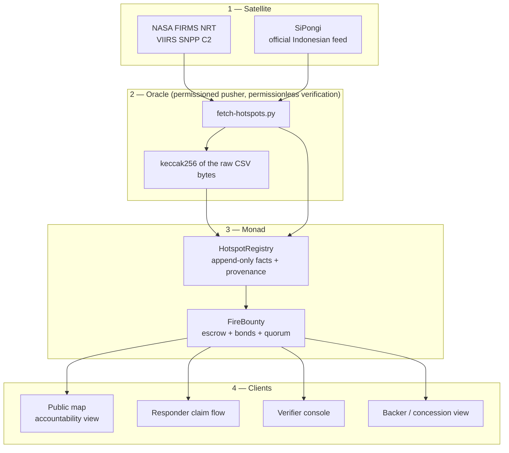
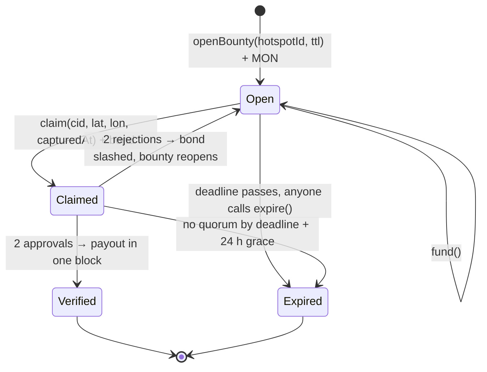
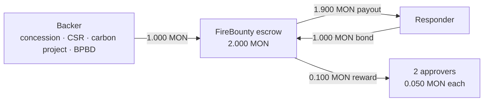
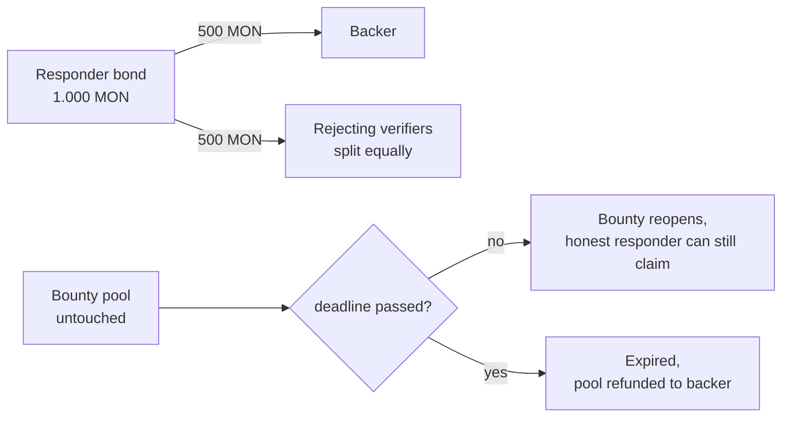

# ASAP: a fire response bounty network on Monad

**Satellites find the fire. Monad pays the person who gets there.**

| | |
|---|---|
| **Version** | 1.0 — build of record, 24 October 2026 |
| **Chain** | Monad Testnet, chain `10143` |
| **Contracts** | `HotspotRegistry` `0xe691172812761cd8c1efcdbeb89192b35cacb9e7` · `FireBounty` `0x6ec281aac8f6bec24ba84c56800879b66c13097a` |
| **Live** | https://asapmonad.web.id · app at `/portal` |
| **Whitepaper** | https://asapmonad.web.id/whitepaper (this document) |
| **Source** | `contracts/src/*.sol`, `web/frontend/` |

Every number in this document was read from the deployed contracts or produced by the test
suites on the date above. Where a figure is an assumption, the assumption is printed next to it.

---

## Abstract

Indonesia's fire detection layer already works. SiPongi ingests NASA Terra/Aqua, SNPP and NOAA-20
and publishes hotspot coordinates daily; on 12 October 2026 the national feed carried **17,108
hotspots** and **26 provinces** were under haze. What does not work is the last mile: a hotspot is
a coordinate, not an action. Someone has to physically reach that coordinate, and today that
person has no budget for the trip, no way to prove they made it, and nobody to invoice.

ASAP is the missing layer between the satellite and the shovel. A hotspot opens an escrow bounty
on-chain. A responder stakes a bond equal to the bounty, submits geotagged photographic evidence,
and two independent verifiers settle the claim. The payout lands in a single block. If nobody
credible arrives, the bounty **expires**, and that expiry is published as a permanent, verifiable
record of a fire that had money on it and was left to burn.

Two contracts, no token, native MON. The design goal is not to replace Manggala Agni, BPBD or the
village brigades. It is to make the first hour of a fire worth somebody's time and money, and to
make the absence of a response impossible to hide.

---

## 1. The problem

### 1.1 The detection layer is solved

| Signal | Value | Source |
|---|---|---|
| National hotspots | **17,108** on 12 Oct 2026 | Kompas / SiPongi, as recorded in [`SPEC.md`](SPEC.md) §1 |
| High-confidence hotspots | **793** on 10 Oct, up 356 day-over-day | SiPongi, Kementerian Kehutanan |
| Provinces under haze | **26** (Aceh → Papua) plus transboundary | BMKG, 15 Oct 2026 |
| Live pull, 24 h window | **22,760** rows in Indonesia's bbox, **919 high-confidence** | NASA FIRMS VIIRS SNPP C2 NRT, pulled during this build |
| Pekanbaru PM2.5 at build time | **55.6 µg/m³** | Open-Meteo air quality |

Two different sensors and two different windows produce the 17,108 and 22,760 figures. They are
never mixed in this document, in the app, or in the pitch.

### 1.2 The response layer is not

Detection produces a coordinate and a timestamp. It does not produce a budget, a contract, or a
payment. The gap between "a satellite saw heat at −1.4233, 104.0830" and "a person is standing
there with a hose" is currently bridged by unallocated goodwill:

- **No budget.** A village volunteer who takes a motorbike 25 km into a peat fire pays for the fuel
  themselves. There is no line item that reimburses that trip within a week, if at all.
- **No proof.** Nobody can prove afterwards who arrived first, how close they got, or when. A
  photograph on WhatsApp is not a record.
- **No accountability.** A fire with no responder leaves no trace beyond the satellite row itself.
  The concession that should have funded a response is never asked why it did not.

The result is a system that is excellent at knowing and poor at acting. ASAP exists to price the
action.

### 1.3 The design constraint that follows

NRT satellite data lags reality by hours, so any system that waits for satellite confirmation
before acting is already late. ASAP uses the satellite for one job only, **opening and scoping a
bounty**, and pays for **arrival**, a fact the responder produces rather than the satellite.

---

## 2. What ASAP is, and what it deliberately is not

| ASAP is | ASAP is not |
|---|---|
| An escrow and settlement layer for physical fire response | A fire detection system. SiPongi and FIRMS already do that |
| A public ledger of which fires were answered | A dispatch or command system. Manggala Agni keeps command |
| A way for exposure-holders to fund response in minutes | A token, a yield product, or a speculative asset |
| A proof-of-arrival protocol with bonded claims | A certification authority. Verifiers are a trusted quorum in v1 |

Six deliberate exclusions, each of which removes a way for the system to fail:

1. **No ERC-20.** Bounties are denominated in native MON. No liquidity bootstrapping, no peg to
   defend, no second asset to explain to a responder in a field.
2. **No indexer.** The app reads state directly through `eth_call` and parses the one event it
   needs from the receipt it just waited for. One less service that can be down at demo time.
3. **No user accounts.** A wallet is the account. There is no email, no password, no session store,
   and nothing to leak.
4. **No concurrent claims.** One active claim per bounty, and rejection reopens it. Concurrency
   would require a race-resolution rule, and a race-resolution rule requires a reviewer with
   discretion. That is a v2 feature with an appeal window, not a v1 shortcut.
5. **No governance UI.** Parameters are owner-settable and every change emits an event. v1
   optimises for auditable, not decentralised.
6. **No mobile app.** The portal is responsive and the claim flow runs in a phone browser, which is
   where the evidence camera already lives.

---

## 3. System architecture

Four layers, two contracts, one source of truth.



**Why two contracts and not one.** Hotspot facts are shared by every bounty and must be verifiable
independently of whoever opened a bounty; money logic changes and facts do not. Splitting them also
lets a second consumer (carbon MRV, an insurer, a provincial dashboard) read the registry without
touching escrowed funds. Every additional contract is also a place where the system can fail, which
is why there are exactly two.

**Trust boundaries.**

| Actor | Can | Cannot | Enforced by |
|---|---|---|---|
| Publisher (oracle) | Commit a batch, append rows | Rewrite a committed batch, alter a file hash | `commitBatch` is one-shot per `batchId`; `fileHash` is public and re-checkable |
| Anyone | Re-download the source CSV and compare its hash | — | `BatchCommitted.fileHash` + `fileUrl` |
| Backer | Open and fund a bounty | Withdraw it once a claim is live | `fund` only in `Open`; settlement paths in `FireBounty` |
| Responder | Claim with bond + evidence | Claim twice, claim outside the radius, backdate evidence | `claim` preconditions |
| Verifier | Attest once per claim | Attest their own claim, attest twice | `hasVoted`, `SelfAttest` |
| Owner | Set verifiers and parameters | Move escrowed funds | No owner withdrawal path exists |

---

## 4. Mechanism design

### 4.1 `HotspotRegistry`: appended facts with provenance

Satellite rows are facts. The registry's job is to make them *checkable* facts rather than a
publisher's assertion.

```solidity
struct Hotspot {
    int32   latE6;      // latitude  × 1e6
    int32   lonE6;      // longitude × 1e6
    uint16  frpDeci;    // Fire Radiative Power (MW) × 10
    uint32  acqTime;    // satellite acquisition time, unix seconds
    uint8   confidence; // 0 low · 1 nominal · 2 high
    bool    exists;
    bytes32 batchId;    // provenance anchor
}
```

Integers only, because Solidity has no floats. Coordinates are micro-degrees (`value × 1e6`), FRP is
deci-megawatts. The largest detections in the live feed are ~320 MW and a `uint16` caps at
6,553.5 MW, so the field will not overflow on this planet.

**Provenance protocol.**

1. The pusher downloads the raw FIRMS CSV and hashes the exact bytes: `fileHash = keccak256(bytes)`.
2. `commitBatch(fileHash, fileUrl, count)` emits `BatchCommitted` and derives
   `batchId = keccak256(abi.encode(fileHash, count))`. One commit per batch, forever.
3. `publish(batchId, rows)` appends rows, deduplicated on `keccak256(latE6, lonE6, acqTime)`.

The oracle can lie about *which* rows it chose to parse. It cannot silently rewrite the source data
after the fact, because the file hash is already on-chain and the URL is public. Any third party can
re-download, re-hash, and disprove a tampered batch in one command. This is a weaker guarantee than
a decentralised oracle and a much stronger one than "trust our database".

Batch size is deliberate: ~200 rows per transaction. Each hotspot occupies two storage slots
(packed metadata plus `batchId`), so a 400-row transaction roughly doubles the gas and buys nothing
but one fewer signature.

### 4.2 `FireBounty`: escrow, bonds, quorum

A bounty is an independent escrow account with four participants: the **backer** who funds it, the
**responder** who claims it, the **verifiers** who settle it, and the **deadline** that closes it.



**Claim preconditions, all enforced on-chain before the bond is accepted:**

| Check | Rule | Reverts with |
|---|---|---|
| Bounty is live | `status == Open` and `block.timestamp <= deadline` | `WrongStatus` / `PastDeadline` |
| Bond covers the bounty | `msg.value >= pool × minBondBps / 10_000`, default `minBondBps = 10_000` | `BondTooSmall(required)` |
| Evidence is not older than the fire | `capturedAt >= hotspot.acqTime` | `BadTimestamp` |
| Evidence is not from the future | `capturedAt <= block.timestamp + 5 min` | `BadTimestamp` |
| Evidence is at the fire | distance ≤ `radiusMeters` (25 km) | `OutsideRadius` |
| Hotspot exists | `registry.exists(hotspotId)` at open time | `UnknownHotspot` |

**Settlement.** `attest(claimId, approve)` records one vote per verifier and settles the moment a
quorum is reached. `settled` is set before any transfer, and both settlement functions carry a
reentrancy guard, so a claim cannot pay twice.

### 4.3 Money flow

The happy path, with the amounts used in the live demo:



`payout = pool + bond − (pool × verifierRewardBps / 10_000)`, so at the default 10 % reward a
successful responder receives **1.9× the pool**: their own bond back plus 90 % of the bounty. The
remaining 10 % pays the two verifiers, split equally. Verification is work, and unpaid verifiers do
not verify.

The rejection path:



The resolver's inaction is treated as the resolver's fault: if a claim is live and verifiers never
reach quorum, `expire` after `deadline + 24 h` returns the **bond to the responder** and the **pool
to the backer**. The responder is not punished for verifier apathy, and no MON is stranded.

### 4.4 The expiry, which is the product

Most fire-tech stops at "a fire was detected". ASAP's terminal state for an unanswered fire is a
public row:

```
BountyExpired(bountyId, hotspotId, refunded)
```

That event is the accountability ledger. It says: **this fire had money on it, a deadline, and
nobody credible showed up.** It is queryable, permanent, and attributable to a hotspot that any
regulator, insurer, or journalist can cross-reference against a concession boundary.

The metric that follows is trivially definable and hard to game:

```
unanswered rate = expired bounties / all bounties ever opened
```

At the time of writing the denominator is 5 and the numerator is 0. No bounty has been left to
expire yet, because the oldest deadline had not elapsed. The metric is honest about being
uninformative at this sample size; it becomes the product at national scale.

---

## 5. Security and game theory

### 5.1 The core incentive: bond ≥ bounty

Let `p` be the probability a fraudulent claim is accepted, `pool` the bounty, `bond` the responder's
stake, and `reward` the verifier cut (10 % of the pool at the default). A fake claim nets
`pool − reward` when it succeeds (the bond comes back as part of the payout) and loses the whole
bond when it is rejected:

```
EV(fake) = p × (pool − reward) − (1 − p) × bond
```

With `bond = pool` and `reward = 0.1 × pool`:

```
EV(fake) = pool × (1.9p − 1)
```

Fraud breaks even at `p = 1/1.9 ≈ 0.53`. So **a fake claim has to succeed more than about 53 % of
the time before lying pays**, and `p` is not one verifier being fooled. It is two independent
whitelisted verifiers both being fooled, while they can see the coordinate, the distance from the
hotspot, the capture delay after the satellite pass, and the photograph. At any plausible `p` the
mechanism is a losing trade.

The bond does not need to make fraud impossible. It needs to make fraud a worse business than
responding. Raising the bond above the pool only sharpens that inequality, which is why
`minBondBps` is bounded below at 10,000 and may be set higher.

**The honest cost of that choice.** A bond of 100 % excludes the poorest responders, who are often
exactly the village volunteers the system is for. This is a documented trade-off, not an
oversight. The mitigation is a **cooperative bond pool** (§11): a third-party or CSR-funded contract
that posts bonds on behalf of vetted responders and takes the slashing risk for a fee.

### 5.2 Threat model

| Attack | Mitigation | Residual risk |
|---|---|---|
| Fake claim with no fire visit | 25 km radius + `capturedAt ≥ acqTime` + two attestations + bond at risk | A real photo of a *different* fire in the same 25 km box |
| Photograph an old fire | Timestamp floor is the satellite acquisition time | EXIF and device attestation are v2 |
| Colluding responder and verifiers | Both verifiers must be whitelisted; self-attestation is blocked; bond halves on rejection | Two compromised whitelisted keys |
| Oracle publishes rows that never existed | `fileHash` of the exact CSV is public and re-checkable; batches are one-shot | Oracle chooses *which* rows to publish |
| Oracle floods the registry | Publisher whitelist; `HotspotPublished` is the permanent audit trail | Owner must curate publishers |
| Spam claims to deny service | One active claim per bounty; bond ≥ pool; rejection reopens | Capital cost is the only barrier. That is intended |
| Reentrancy on payout | `nonReentrant` on both settlement paths and on `expire`; state zeroed before `call` | — |
| Double settlement | `settled` flag set before transfer; `AlreadySettled` | — |
| Verifier griefing an honest claim | Symmetric quorums; rejection needs 2 of the whitelist; bond returns on verifier timeout | Collusion of two verifiers |
| Owner key compromise | No owner path touches escrow. The owner sets verifiers and parameters only | Malicious verifier whitelist is a real, disclosed power |
| Bounty exceeds the value of the fire it prevents | Documented policy: a bounty must never exceed the fire's cost | Perverse incentive in principle; bounded in practice by backers |

### 5.3 Invariants, and where they are asserted

| # | Invariant | Test |
|---|---|---|
| 1 | A claim cannot settle twice | `settled` before transfer |
| 2 | Bond is always ≥ pool at claim time | `testBondMustCoverPool` |
| 3 | Evidence cannot predate the satellite pass | `testEvidenceCannotPredateSatellitePass` |
| 4 | Evidence must be inside the radius | `testEvidenceMustBeInsideRadius` |
| 5 | A verifier cannot attest their own claim | `testVerifierCannotAttestOwnClaim` |
| 6 | Two rejections slash the bond and reopen the bounty | `testRejectionSlashesBondAndReopens` |
| 7 | An unanswered bounty refunds the backer | `testExpireRefundsBackerWhenNobodyAnswers` |
| 8 | Contract balance is zero in every terminal state | `testHappyPathPaysResponder` asserts `address(bounty).balance == 0`; `testRejectionSlashesBondAndReopens` asserts only the still-escrowed pool remains; `testExpireRefundsBackerWhenNobodyAnswers` asserts the backer is made whole |

`forge test` → **7 passed, 0 failed**. The full happy path (open a bounty, claim with a bond, two
attestations, payout) executes within **663,799 gas** in the suite.

---

## 6. Parameters and governance

All parameters are owner-settable, bounded, and emit an event on every change. They were read from
the deployed `FireBounty` for this document.

| Parameter | Value on-chain | Bound | Rationale |
|---|---|---|---|
| `verifierQuorum` | **2** | `> 0` | One attestation is one compromised key away from a fake payout |
| `rejectQuorum` | **2** | `> 0` | Symmetric, so one grudge cannot slash an honest responder |
| `verifierRewardBps` | **1,000** (10 %) | `≤ 3,000` | Verification is work; the cap prevents verifiers eating the bounty |
| `minBondBps` | **10,000** (100 %) | `≥ 10,000` | The bond can be raised, never lowered below the pool |
| `radiusMeters` | **25,000** | free | Half a district: tight enough to mean something, loose enough for a burned area |
| `MAX_TTL` | **24 h** | immutable | Most fires are actionable within a day |
| `ATTESTATION_GRACE` | **24 h** | immutable | A day of slack before verifier inaction becomes an expiry |
| `CLOCK_SKEW` | **5 min** | immutable | Tolerates phone clock drift without opening a timestamp hole |

**Owner powers, stated plainly.** The owner can whitelist publishers and verifiers and change the
five tunables above. The owner cannot withdraw escrowed MON, cannot force a settlement, and cannot
rewrite a committed batch. A malicious owner can whitelist a colluding verifier set. That is the
centralised part of v1, and it is disclosed in §10.

**Deployment.** Foundry, `solc 0.8.24`, optimizer on, 200 runs, `shanghai` EVM. `FireBounty` takes
the registry address as its only constructor argument. Both contracts are verified on Monadscan by
exact match, with Sourcify as an independent second source. The deploying address is also a
whitelisted verifier so the flow can be demonstrated end to end without pretending otherwise.

---

## 7. Why Monad, specifically

"It's fast" is what every submission says. The claim here is narrower: this workload has three
properties that make an expensive or sequential chain structurally wrong.

### 7.1 The workload is embarrassingly parallel

Every hotspot is an independent escrow with its own bond, quorum, and settlement. There is no state
shared between hotspot #1 and hotspot #2. A day of national data is **~22,760 detections**; with
claims, attestations, top-ups and payouts that is tens of thousands of *independent* state
transitions per day. Monad executes independent transactions in parallel; a sequential-execution EVM
serialises them. This is the shape of workload parallel execution was built for, not a benchmark.

### 7.2 Micro-bounty economics decide whether the mechanism exists at all

A bounty for a village volunteer is on the order of $10–30. Fee drag is `actions × cost / bounty`.
Illustrative arithmetic, assuming four on-chain actions per settled bounty:

| Gas cost per action | Fee drag on a $20 bounty | Verdict |
|---|---|---|
| $0.20 | 4.0 % | The mechanism is taxed before it pays anyone |
| $0.02 | 0.40 % | Tolerable |
| $0.002 | 0.04 % | Invisible. The bounty is the whole product |

The fee figures are illustrative; the point is the shape of the curve. At $0.20 per action a
responder's bond and the backer's budget are already paying a visible tax, and a Rp 150k–500k
bounty stops making sense. The mechanism does not degrade gracefully: below a certain fee it
exists, above it, it does not.

### 7.3 Finality is functional, not cosmetic

A responder standing in smoke should not wait thirty seconds to learn whether their evidence landed
while a second responder claims the same fire. 800 ms finality changes behaviour in the field, not
just the interface. One active claim per bounty makes this acute: the first credible claim wins the
whole pool.

### 7.4 Gas is charged on `gas_limit`, not gas used

This is a Monad-specific operational fact with a direct cost. With 200-hotspot batch writes, blindly
using the `eth_estimateGas` default overestimates the limit and burns real money on **every** batch.
ASAP sizes the limit from measured gas plus a small buffer, and treats the batch size of 200 as a
gas-budget decision rather than a convenience.

---

## 8. Evidence: from a phone camera to a hash on-chain

Photographic proof is the weakest link in any physical-world protocol, so the pipeline is explicit
about what it does and does not prove.

```
camera → canvas downscale to 1280 px, JPEG q0.82 → SHA-256 of the bytes
      → POST /api/evidence → R2 object keyed by that SHA-256
      → content-addressed URL → keccak256(url) written to FireBounty, raw URL in the event
```

| Stage | Implementation | Property gained |
|---|---|---|
| Capture and compress | `web/frontend/src/lib/compress.ts`: 1280 px long edge, JPEG q0.82 | A 6 MB phone photo becomes a few hundred KB, inside the 8 MB cap |
| Content addressing | `evidence.ts`: the R2 key **is** the SHA-256 of the bytes, `^[a-f0-9]{64}\.(jpg\|png\|webp)$` | The same photo always resolves to the same immutable object; nobody can overwrite someone else's proof |
| Storage | Cloudflare Worker + R2, `Cache-Control: immutable` | Cheap, durable, no server to babysit, no account to create |
| On-chain | `evidenceHash = keccak256(bytes(url))`, raw URL in `ClaimSubmitted` | 32 bytes on-chain, full evidence in the log: the usual hash-on-chain, payload-in-the-event split |

The claim button in the app stays disabled until three conditions hold: a wallet is connected, the
photo is stored and its URL resolved, and the **required bond has actually been read from the
contract**. The third one matters: a bond computed client-side is a quiet way to send a transaction
that reverts.

**What this proves and what it does not.** It proves the evidence object is exactly what the
responder submitted, unmodified and retrievable by anyone, forever. It does not prove the photo was
taken at that coordinate at that time. The 25 km radius, the timestamp floor, two attestations and the
bond bound how much that matters. Solving it fully needs EXIF signing and device attestation in v2.

---

## 9. The application

The front end is a reader of two contracts, not a database client. There is no backend to be stale.

| Surface | What it does |
|---|---|
| **Public map** `/portal` | Leaflet map of on-chain hotspots, marker radius scaled by FRP. Colour is contract state: amber `Open`, blue `Claimed`, green `Verified`, red `Expired`. Header counters: hotspots, open bounties, total escrow, and **fires with no responder**. |
| **Hotspot detail** | Coordinates resolved to words ("≈58 km NE of Palangka Raya") because `-2.1234, 113.5678` tells a responder nothing. FRP percentile ("stronger than 78 % of the fires here") because 42 MW is a number nobody can rank. |
| **Open a bounty** | Anyone with MON can fund a hotspot. `openBounty(hotspotId, ttl)` with `ttl ≤ 24 h`. |
| **Claim** | Camera or file input, browser-side compression, upload, bond read from `requiredBond()`, one `claim()` transaction. |
| **Verifier** | The queue is the contract: `Open` vs `Claimed`, distance from the fire, capture delay, evidence preview, two `attest()` buttons. |
| **Receipt** | On a verified bounty: responder, distance, evidence, approvals, verifier reward. The exact payout is parsed from the `ClaimVerified` event of the settlement receipt this browser waited for; a bounty settled in an earlier build says "settled before this build" rather than inventing a number. |

**Engineering constraints discovered from the public RPC, not assumed.** The official endpoint allows
roughly 15 req/s and rejects bursts with 429; `eth_getLogs` is capped at 100 blocks; Multicall3
returned inconsistent results through it. The client therefore uses no logs and no multicall: one
`eth_call` per id, paced in waves, with a read-only fallback chain ordered by measured behaviour
(ankr first, the official node second as the trusted opinion, drpc last). This is the least elegant
option and the most reliable one, and a demo cannot afford an empty map because one endpoint got
moody.

**Test coverage.** 15 test files, **219 passing Vitest tests**, covering geo maths, bond gating,
receipts, the evidence pipeline, deep links, both wallet paths, and both interaction components.
Plus **7 Foundry tests** on the contracts.

---

## 10. Known limitations

Stated before anyone else states them.

| Limitation | Honest position |
|---|---|
| Satellite NRT lags reality by hours | Correct, and exactly why the ground layer must not be gated on the satellite. ASAP pays for arrival; the satellite only opens the bounty. |
| Radius check is a flat-earth approximation | Within 8° of the equator `cos(lat) ≥ 0.990`, so the error is ~1 % at 25 km. Real haversine is a v2 line item. The app uses the identical formula, so the receipt and the contract cannot disagree about what "25 km" means. |
| One active claim per bounty | Deliberate. Concurrent claims need race resolution, race resolution needs a reviewer with discretion, and discretionary review needs an appeal window. That is v2, not a shortcut. |
| Verification is a trusted quorum | True. The bond makes lying unprofitable and the quorum makes collusion expensive, but a malicious owner plus two keys is a real attack. v2: stake-weighted verifiers with a slashing appeal window. |
| Evidence can be a photo of a different fire | Mitigated (timestamp floor, 25 km radius, two attestations, bond at risk), not solved. |
| Publisher whitelist is permissioned | Deliberate. A permissionless pusher is a DDoS surface, and the file hash is what makes a lying publisher detectable. |
| Paying for fire reports has perverse incentives | Real. Bond, radius, timestamp and quorum bound it, and a bounty must never exceed the cost of the fire it prevents. |
| IDR is a display rate, not a settlement rail | The UI reads a `MON_IDR` rate for readability. Responders are paid in MON and bear the conversion themselves until v3 off-ramp. |
| The unanswered-rate metric has n = 5 | Honest: it is 0 of 5 today and says nothing yet. It is defined precisely so it can be tracked from the first day it matters. |

---

## 11. Roadmap

Each phase is scoped by what it unlocks, not by what it sounds like.

| Phase | Item | Why it is next |
|---|---|---|
| **v1.1** | Haversine radius; EXIF + device-signature attestation; per-claim bond top-ups | Closes the two "mitigated, not solved" rows |
| **v1.2** | **Cooperative bond pool**: a contract that posts bonds for vetted village brigades and takes the slashing risk for a fee | Directly answers the strongest objection to `bond = 100 % pool`, which is exclusion of the poorest responders |
| **v2** | Stake-weighted verifiers, an appeal window, and a slashing schedule for verifiers who attest wrongly | Replaces the centralised trust root with an economic one |
| **v2.1** | Envio indexer + public API | Makes the expiry ledger queryable at national scale; today's app deliberately avoids logs |
| **v3** | Parametric backer policies: a concession or insurer funds bounties automatically for hotspots inside its boundary; MON→IDR off-ramp for responders | Turns the product from a tool into a market, and removes the last friction for a volunteer with no exchange account |

The order is a dependency order. The bond pool before stake-weighted verifiers, because the
exclusion problem is more urgent than the decentralisation problem; the indexer after v2, because
today's sample size does not justify the infrastructure.

---

## 12. State of record

Read from the deployed contracts on 24 October 2026.

| Item | Value |
|---|---|
| Hotspots registered | **180** |
| Bounties opened | **5** |
| Claims submitted | **2** |
| Verified settlements | **1** (§12.1) |
| Claimed, awaiting quorum | **1**: bond `0.05 MON`, 0 approvals |
| Open, unfunded by a responder | **3**: `0.02 + 0.01 + 0.01 MON` = **0.04 MON** in escrow |
| Expired ("no responder") | **0** |
| Registry source | NASA FIRMS VIIRS SNPP C2 NRT, batch `0x89eb56…` anchored to the keccak256 of the raw CSV |

### 12.1 The one end-to-end settlement

| Field | Value |
|---|---|
| Bounty / claim | `#1` / `#1` |
| Hotspot | `#1`: `-1.423340, 104.082950`, on Sumatra's east coast, ≈57 km ENE of Jambi; FRP 289.6 MW; high confidence |
| Satellite acquisition | 2026-10-22 23:29 UTC |
| Responder | `0xbe500Dd19a075af040279612bE845563a8A81B73` |
| Evidence coordinates | `-1.423340, 104.082950`, distance 0 m, inside the 25 km radius |
| Evidence captured | 2026-10-24 05:10 UTC, after acquisition, as the contract requires |
| Approvals | **2** of quorum 2 → settled |
| Status | `Verified`, pool zeroed, bond returned with the payout |

This is the record that matters: a real hotspot from the live FIRMS feed, a real bond, two
attestations, and a responder paid in one block. Everything else in this document is design; that
row is the proof.

---

## 13. Conclusion

Indonesia does not have a detection problem. It has a last-mile problem: the satellite knows, and
nobody is paid to act on what it knows. ASAP stays small on purpose. Two contracts, native MON, no
token, no indexer, no accounts, because only one sentence has to work:

> **A hotspot opens a bounty, and the first person who can prove they got there gets paid.**

What keeps that sentence honest is small too: a bond equal to the bounty, a timestamp floor, a 25 km
radius, and two attestations. What makes it worth anything is the state nobody else publishes:
`Expired`, a fire with money on it and nobody who came.

The chain choice follows from the workload. Thousands of independent escrows a day need parallel
execution. A Rp 150k bounty only makes sense while the fee is noise. And a person standing in smoke
cannot wait thirty seconds to find out whether their proof landed.

---

## References

1. NASA FIRMS — Fire Information for Resource Management System, VIIRS SNPP C2 NRT. https://firms.modaps.eosdis.nasa.gov/
2. SiPongi — Sistem Informasi Karhutla, Kementerian Kehutanan Republik Indonesia. https://sipongi.menlhk.go.id/
3. BMKG — Badan Meteorologi, Klimatologi, dan Geofisika, haze and air quality bulletins, October 2026. https://www.bmkg.go.id/
4. Kompas, national hotspot count of 12 October 2026 (17,108), as recorded in [`SPEC.md`](SPEC.md) §1.
5. Open-Meteo Air Quality API — PM2.5 at Pekanbaru during this build.
6. Monad documentation — execution model, finality, and gas accounting. https://docs.monad.xyz/
7. Contract sources and tests in this repository: `contracts/src/HotspotRegistry.sol`, `contracts/src/FireBounty.sol`, `contracts/test/FireBounty.t.sol`.
8. Monadscan (chain 10143): [`HotspotRegistry`](https://testnet.monadscan.com/address/0xe691172812761cd8c1efcdbeb89192b35cacb9e7) · [`FireBounty`](https://testnet.monadscan.com/address/0x6ec281aac8f6bec24ba84c56800879b66c13097a)

---

## Appendix A: contract API

**`HotspotRegistry`**

| Function | Access | Purpose |
|---|---|---|
| `commitBatch(bytes32 fileHash, string fileUrl, uint32 count) → bytes32` | publisher | Anchor a source file before writing rows |
| `publish(bytes32 batchId, HotspotInput[] inputs)` | publisher | Append parsed rows, deduped |
| `setPublisher(address, bool)` | owner | Curate oracle operators |
| `getHotspot(uint256) → Hotspot` · `exists(uint256) → bool` | anyone | Reads |

**`FireBounty`**

| Function | Access | Purpose |
|---|---|---|
| `openBounty(uint256 hotspotId, uint32 ttl) payable → uint256` | anyone | Fund a bounty, `ttl ≤ 24 h` |
| `fund(uint256 bountyId) payable` | anyone | Top up while `Open` |
| `claim(uint256 bountyId, string evidenceCid, int32 latE6, int32 lonE6, uint32 capturedAt) payable → uint256` | anyone | Evidence + bond |
| `attest(uint256 claimId, bool approve)` | verifier | One vote per verifier per claim |
| `expire(uint256 bountyId)` | anyone | Close a stale bounty; emits `BountyExpired` |
| `requiredBond(uint256) → uint256` | anyone | What to post right now |
| `setVerifier` · `setParams` · `setMinBondBps` | owner | Governance, no escrow access |
| `getBounty` · `getClaim` · `approversOf` · `rejectersOf` | anyone | UI reads |

**Events** (the whole indexer, for now): `BatchCommitted`, `HotspotPublished`, `BountyOpened`,
`BountyFunded`, `ClaimSubmitted`, `ClaimAttested`, `ClaimVerified`, `ClaimRejected`, `BountyExpired`.

## Appendix B: reproducing every number here

```bash
cd contracts && forge test -vv                      # 7 passed
cd web/frontend && npm test                          # 219 passed

export PATH="$HOME/.config/.foundry/bin:$PATH"
RPC=https://testnet-rpc.monad.xyz
R=0xe691172812761cd8c1efcdbeb89192b35cacb9e7
B=0x6ec281aac8f6bec24ba84c56800879b66c13097a

cast call $R 'hotspotCount()(uint256)'      --rpc-url $RPC   # 180
cast call $B 'bountyCount()(uint256)'       --rpc-url $RPC   # 5
cast call $B 'claimCount()(uint256)'        --rpc-url $RPC   # 2
cast call $B 'getBounty(uint256)((uint256,address,uint96,uint64,uint256,uint8))' 1 --rpc-url $RPC
cast call $B 'getClaim(uint256)((uint256,address,uint96,int32,int32,uint32,bytes32,uint16,uint16,bool))' 1 --rpc-url $RPC
```
